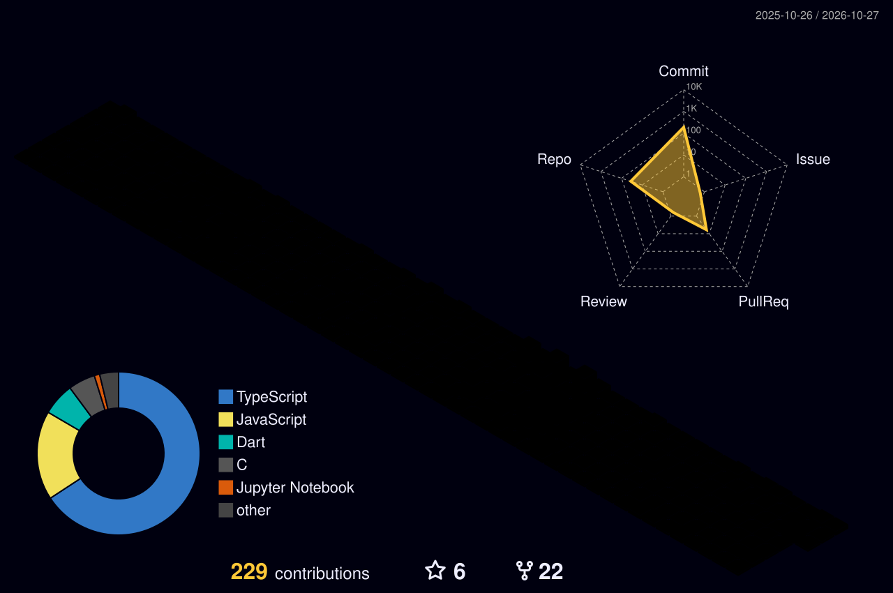

<!-- 🔧 Replace every USERNAME with your GitHub username (the repo must be named USERNAME/USERNAME) -->

<!-- ═══════════════ HEADER ═══════════════ -->
<div align="center">


<a href="https://git.io/typing-svg">
  
</a>

<br/>


</div>

<!-- ═══════════════ ABOUT ═══════════════ -->

## 👨‍💻 &nbsp;About Me

```js
const soumya = {
  role:      "Web Developer & CS Student",
  location:  "Odisha, India 🇮🇳",
  focus:     ["Full-Stack Web", "Civic Tech", "Heritage & Culture x Tech"],
  currently: "Prepping for the next hackathon 🚀",
  learning:  ["System Design", "TypeScript", "Cloud & DevOps"],
  funFact:   "I debug with console.log and I'm not ashamed of it",
  mission:   "Build socially impactful products that people actually use",
};
```

<!-- ═══════════════ TECH STACK ═══════════════ -->

## 🛠️ &nbsp;Tech Arsenal

<div align="center">


<br/>


</div>

<!-- ═══════════════ STATS ═══════════════ -->

## 📊 &nbsp;GitHub Stats

<div align="center">


<br/>


</div>

<!-- ═══════════════ CONTRIBUTIONS ═══════════════ -->

## 🔥 &nbsp;Contribution Zone

### 🐍 The Contribution Snake
> *Watch the snake eat my commits. Generated daily by a GitHub Action.*

<div align="center">
  <picture>
    <source media="(prefers-color-scheme: dark)"  srcset="https://raw.githubusercontent.com/SoumyaPatnaik1808/SoumyaPatnaik1808/output/github-snake-dark.svg" />
    <source media="(prefers-color-scheme: light)" srcset="https://raw.githubusercontent.com/SoumyaPatnaik1808/SoumyaPatnaik1808/output/github-snake.svg" />
    
  </picture>
</div>

### 📈 Activity Graph

<div align="center">
  
</div>

### 🧊 3D Contribution Calendar

<div align="center">
  
</div>

<!-- ═══════════════ PROJECTS ═══════════════ -->

<!-- ## 🚀 &nbsp;Featured Projects

<div align="center">

<a href="https://github.com/SoumyaPatnaik1808/PROJECT-1">
  
</a>
<a href="https://github.com/USERNAME/PROJECT-2">
  
</a>

<a href="https://github.com/USERNAME/PROJECT-3">
  
</a>
<a href="https://github.com/USERNAME/PROJECT-4">
  
</a> -->

</div>

<!-- ═══════════════ TROPHIES ═══════════════ -->

## 🏆 &nbsp;Trophy Case

<div align="center">
  
</div>

<!-- ═══════════════ CONNECT ═══════════════ -->

## 🌐 &nbsp;Let's Connect

<div align="center">

<a href="https://linkedin.com/in/soumya-patnaik-8943623a7"></a>
<a href="mailto:patnaiksoumya20@gmail.com"></a>
<!-- <a href="https://twitter.com/YOUR-HANDLE"></a> -->
<!-- <a href="https://YOUR-PORTFOLIO.com"></a> -->

<br/><br/>


</div>